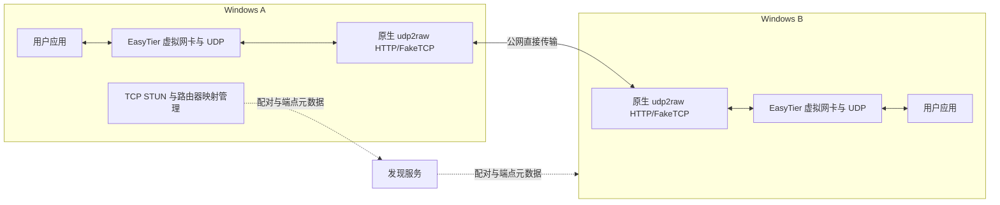

# 产品与架构决策

设计日期：2026-10-09；定位修订：2026-10-10。已有原生预览版，历史性能见[实测](初版实测报告-20261010.md)。0.1.1 去除特定应用角色绑定，任一端均可发起接收方向测速。0.2.0 已实现并联调独立发现服务、Windows 后台服务、持久配对、STUN 列表编辑及自动入口协商；首次仍需手动传递长邀请。当前 GUI 仍为管理员界面。以下为产品规则，未完全落地的项目保留后续标注。

## 目标与事实边界

产品是以 udp2raw 与自动打洞为基础的通用 P2P 组网工具，重点改善 UDP 在特定 QoS 环境下的可用性。向用户交付虚拟 IP、对端信息、连接状态和链路质量；组网后运行何种应用由用户决定。Sunshine/Moonlight、远程桌面、文件传输、联机应用都只是使用场景，不决定基础架构、设备身份、网络角色或服务生命周期。

首次安装由软件准备配套组件；A 创建网络，B 输入邀请信息，软件完成地址发现、映射、直连和虚拟 IP 分配，无须单独维护 Lucky/EasyTier 配置。首版实现两台 Windows，设计不能写死 Akane、Thinkbook 或某个应用的服务端/客户端方向。

用户已选择：**首版原生 Windows，允许发现服务，禁止业务数据中继**。不以 WSL 作为安装器隐藏依赖。

## 2026-10-10 确认的通用产品规则

### 组网身份与连接方向

- 用户角色采用“创建网络 / 加入网络”；连接方向采用“提供入口 / 主动连接”。0.2.0 已分离：创建者固定槽位 1，加入者固定槽位 2，传输入口可选任一可用端。
- 不设置“主发视频端 / 主收视频端”。数据通道双向，应用可以由任一端提供服务。
- 0.2.0 连接策略提供“自动（记住上次成功方向） / 优先本机提供入口 / 优先对端提供入口”。优先项是尝试顺序，不能让不可达端点被标为连接成功。
- 自动策略先验证同一网络环境下的成功历史，再结合当前公网可达性和映射能力选择入口。NAT1/NAT4 标签只作提示，TCP 实际入站验证优先于标签；换网、网关变化或连续失败时让缓存失效。
- 两端通过认证信令协调角色，冲突用一致规则解决，健康连接不因评分波动反复切换。成功方向、服务器、网关缓存属于设备/网络配置，不硬编码机器名。

### STUN 服务器配置

- 提供服务器列表的增删改、启用/禁用、优先级、导入/导出；保存协议能力、最近成功时间、延迟与失败冷却。
- 允许导入 Lucky 中用户使用的 STUN 地址列表，不复制闭源实现，不绑定 Lucky 安装。当前只读找到 Akane 的 `lucky_stun.lkcf` 二进制配置，尚未取得完整明文列表，不将猜测值标成 Lucky 默认列表。
- TCP 与 UDP 分别实测，UDP 可用不代表支持 TCP。公共默认项与自定义项分开，更新默认列表不能覆盖用户修改。
- 启动优先使用最近成功且本网络仍适用的服务器，不每次扫描全表。候选健康检查不能扰动正在使用的源端口映射；切换后重新核实端点。

### 地址发布与后台服务

- 分别显示“映射已发现 / 本机组件就绪 / 对端直连成功”；STUN 返回地址不能直接标成组网成功。
- 地址发现后先发布候选，本机传输初始化同步推进；就绪状态随信令更新，连接方有界重试。
- Windows 服务托管映射、udp2raw、EasyTier、保活和重连，系统启动即可运行，不依赖登录或 GUI。GUI 只负责控制与展示，关闭 GUI 不等于停止网络，提供明确的“停止网络”操作。
- 网络未就绪时后台重试，不在服务启动回调中长时间等待 STUN。服务崩溃恢复与网络重连分层处理。
- 配对后保存持久设备身份、授权对端和角色偏好；短期邀请仅用于首次配对，不能每天要求登录桌面重新配对。机器级配置目录、密钥保护和本机管理权限配套实现。
- 信令仅交换认证后的地址、能力和状态，不承载业务；端点更新包含有效期和代次。0.2.0 已部署用户自有服务器并验证端点更新；注册本地服务仍不能替代实际双端握手验收。

### 应用优化独立可选

通用模式可单独使用，不检测或强制安装 Sunshine/Moonlight。后续提供低延迟、吞吐优先及特定应用配置时，应明确调整哪些参数、可关闭并可回退。通用验收以双向 IP 可达、TCP/UDP 业务、吞吐、丢包、延迟与恢复为基础；游戏串流只是附加场景。

参考：[Microsoft Windows 服务](https://learn.microsoft.com/en-us/dotnet/core/extensions/windows-service)、[服务与交互桌面隔离](https://learn.microsoft.com/en-us/windows/win32/services/interactive-services)。服务在未登录时建立网络，具体应用是否可在登录前工作不属于组网成功判定条件。

现有参考路径完成了 50 Mbps、180 秒、937486 包全部收到的完整组网测试；随后用户报告游戏串流未丢帧，显示延迟约 16 ms 或更低。用户实玩码率、时长和延迟指标定义未完整记录，因此不能把这条反馈写成“50 Mbps 长期零丢包”或网络 RTT 的实测值。

此前无 HTTP 的 udp2raw 短测也达到过 50 Mbps。HTTP Host 对当前运营商分类的因果作用仍未确认，产品不承诺永久绕过全部 QoS。显示“当前直连及质量达标”，不显示“已破解运营商限速”。

## 组件分工

1. **Windows 控制程序**：计划使用自包含 .NET 桌面程序和受限权限的后台服务。统一处理设备身份、配对、组件生命周期、故障诊断、更新及日志。后续界面可采用普通用户授权模型；0.2.0 界面仍需管理员权限，驱动和防火墙操作由服务执行。首次安装需要系统管理员授权，不要求用户分别安装各组件。
2. **映射管理器**：独立实现 TCP STUN、保活、端点更新与路由器 UPnP/NAT-PMP/PCP 能力适配。首先验证当前路由器的直接转发模式。保留“导入已有 Lucky 映射”作为开发对照和高级兼容入口；最终正常安装不依赖 Lucky。
3. **传输内核**：基于固定的 udp2raw HTTP 分支。WinDivert 提供 IP 包截获和注入，Windows 原生事件循环管理 UDP、定时器及会话。保持数据报独立传递，不引入 TCP 有序重传。
4. **组网内核**：先封装已验证的 EasyTier 2.6.4 独立进程，避免同时重写 Mesh 和传输。最终内置所需 core、管理接口及 Wintun，不依赖用户已有安装路径。
5. **发现服务**：只做配对信令和端点登记。不存在 TURN、串流代理或备用业务中继；已建立的 P2P 不依赖服务逐包转发。服务中断时已建立连接应继续工作；公网映射变更时，远端可能要等服务恢复才能获取新端点。

首版采用多进程隔离，方便固定版本、替换组件及回滚。是否将 EasyTier 内嵌为库，待稳定后按收益评估；不是一键安装的前提。

## Lucky 兼容性的实际难点

Lucky 仓库明确说明公开源码只到 1.4.10；本地检出虽有 2.27.2 更新记录，但没有当前 STUN 模块实现。不能把旧源码的 MIT 声明视作当前闭源二进制的任意重分发许可。[Lucky 官方仓库](https://github.com/gdy666/lucky)

Natter 的 `StunClient._get_mapping` 实际执行 TCP STUN Binding、解析映射，并结合独立保活连接复用来源端口。它为理解映射生命周期提供参考，但源码使用 GPLv3，不能不加说明地复制到其他许可的组件。[Natter 源码](https://github.com/MikeWang000000/Natter/blob/ce1427650178167d2330c490d2e5cd979223e9a4/natter.py)

实现按 STUN 标准独立编写。必须处理 TCP 分段读取、消息长度、事务 ID、属性对齐、XOR-MAPPED-ADDRESS、超时及服务端切换，不能把一次 `recv` 当成完整报文。STUN 只提供映射发现等工具，本身不保证穿透成功。[RFC 8489](https://www.rfc-editor.org/rfc/rfc8489.html)

当前路径的关键是：**路由器把映射端口直接送到 udp2raw 的原始 TCP 端口**。若改为普通 TCP socket 接收后转发字节流，会改变 FakeTCP 语义，不能视作等价替换。

从“已有 Lucky 规则”升级到“新机器零配置”还须解决：

- Windows 源端口绑定、STUN 探测及保活共存，与 Linux 的端口复用行为不同。
- 路由器是否支持自动创建 TCP 映射、源端口是否保持、既有规则是否冲突。
- 家庭路由器和运营商两层 NAT 的映射寿命、目标地址依赖行为。
- 公网端口变化后，先发布带递增代次的端点，再让对端重连；旧端点消息不得覆盖新值。
- 外部可达性应由配对端执行受控握手验证；看到 STUN 返回公网地址不等于入站可达。

本机程序不能保证任意两台 Symmetric NAT 设备都可直连。优先由具备可达 TCP 映射的一端承担传输监听，另一端主动连接；两端安装的是同一个软件，角色由能力协商决定。两边均不可达时明确报告原因，不悄悄改走中继。

## EasyTier 与非中心组网

保留 EasyTier 的虚拟网卡、节点身份、加密和路由能力，由控制程序向它提供本机 UDP 连接器。公网只暴露 udp2raw，内层监听尽量绑定回环地址，管理 RPC 只监听回环。

首版首先完成双端配对；扩展为多节点时，为需要通信的节点对建立独立 udp2raw 连接。本地 UDP 端口到远端节点的对应关系归控制程序管理。组网身份和设备发现可以分布式传播，但不能把“Mesh 能找到多跳路线”当成满足“禁止业务中继”。

固定 EasyTier 配置需关闭外部共享节点、自动业务 TCP 回退及独立打洞。使用当前版本真实支持的 `p2p_only` 限制业务仅发往直接邻居，并核对 peer ID、下一跳及路由；不能照搬新版本才有的参数。已阅读的 `peer_manager.rs::check_p2p_only_before_send` 会拒绝非直接对等节点，已安装二进制也提供该开关。

生产验收必须证明无通用 TCP、QUIC、公共节点等备用路径。发现服务地址绝不能作为 EasyTier 业务 peer 写入配置。

## 通用性能策略与可选低延迟配置

- 初始 MTU 1280，测量内外层报文开销与路径 MTU，再决定是否上调；不能仅测 1200 字节流量。
- 关注 40/50 Mbps 视频码率加音频、控制、冗余和瞬时突发后的真实线速。Akane 当前 100 Mbps 物理链路也必须纳入预算。
- 保留 UDP 丢包后继续交付后续数据的行为；队列有上限，避免持续积压过期视频。
- 先记录包速率、发送失败、接收队列溢出、CPU、RTT P50/P95/P99 和业务丢帧；不依赖单一平均速度。
- 业务运行期间不自动跑满带宽测速、不盲目并联多通道或叠加 FEC。额外冗余可能加剧已有共享限速，先根据丢包形态决定。
- HTTP 特征只在既有协议行为范围内作为可选配置；支持无 HTTP 对照。TLS/HTTPS 是单独的后续研究，当前没有 TLS 握手或合法 TLS Record 层。
- 自动恢复要检测链路速度下降、映射失效、休眠唤醒和设备切换；禁止只显示“进程还活着”就宣称连接正常。

## 身份、发现与生命周期

配对邀请使用足够随机的秘密和有效期，不能把易枚举的六位数字直接当网络长期密钥。设备生成持久密钥，Windows 用 DPAPI 或等效系统机制保护；端点更新要认证、抗重放和过期失效。发现服务仅获取建立连接所需元数据，日志不收集网络密钥。

控制程序采用 `预检 → 映射 → 发布 → 直连握手 → 组网 → 质量确认 → 运行/恢复 → 停止` 状态机。失败必须指出卡在哪一步。进程用 Job Object 或服务生命周期托管，避免依赖 SSH 窗口存活。

所有防火墙规则、路由器租约、临时文件和虚拟网卡都带本软件所有权。建立前记录恢复信息；退出/崩溃恢复时只清理自身对象，不关闭别人的 EasyTier/Lucky，不改全局 DNS、默认路由或 WSL 配置。升级前保留旧二进制和兼容配置，失败回滚。

## 0.2.0 落地边界（2026-10-10）

新增 StreamLink.Service 与 StreamLink.Discovery。机器级配对配置使用 DPAPI + 管理员/SYSTEM ACL，命名管道拒绝远程 SMB，客户端核对 SCM 服务 PID 后才发送配对信息。服务运行在 Session 0，通过 Job Object 约束自己启动的组件。

创建端承担本轮双端入口协商的协调者，不承担业务中继；对双方候选排序，实际成功后记忆入口。设备槽位固定虚拟 IP，不随传输监听/连接角色改变。发现服务通过 HTTPS 接收最多两个授权槽位的 AES-GCM 加密公告，端点有 120 秒寿命与递增版本，拒绝旧版本和不同设备占用已有槽位。

已实现 STUN 列表编辑/导入/导出与最近成功服务器优先；尚未实现每服务器延迟统计、自动测速排序、启用开关、网关缓存或完整 NAT 分类。UPnP 仍每次重新发现。默认传输仍为 FakeTCP + HTTP，纯 UDP 路径不宣称已突破 QoS。

发现服务通过已有 HTTPS 域名的独立路径发布。私有源站与生产 443 服务分开；第三方 TLS 终止可见认证元数据，但没有端点明文密钥。它不是去中心化发现系统；数据面仍是无中继的 P2P。详见发现服务运维.txt。
